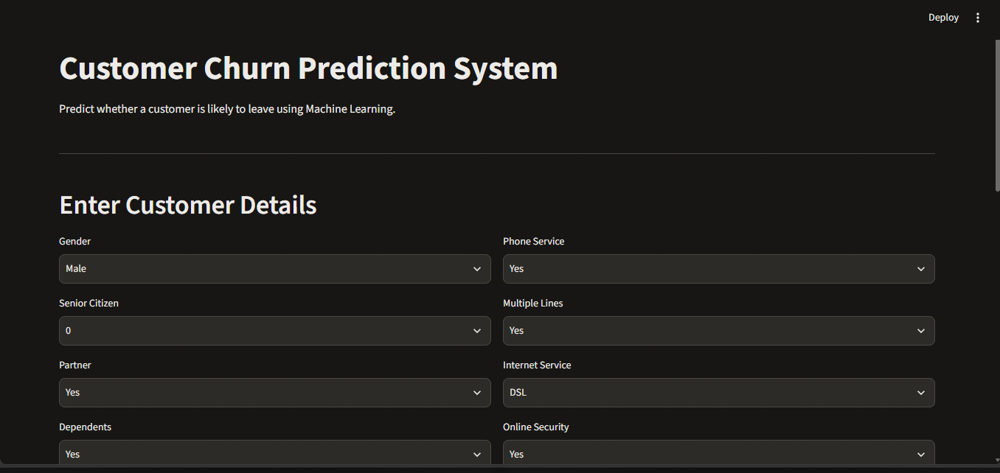

# Customer Churn Prediction System

A Machine Learning project that predicts whether a telecom customer is likely to leave the company using customer demographics, subscription details and billing information.

## Application Preview



## Project Overview

Customer churn is a major challenge for telecom companies. This project uses machine learning classification algorithms to identify customers who are likely to discontinue their services.

The system includes data preprocessing, exploratory data analysis, model training, evaluation and an interactive Streamlit application.

## Technologies Used

- Python
- Pandas and NumPy
- Matplotlib and Seaborn
- Scikit-learn
- Streamlit
- Joblib

## Dataset

- Dataset: IBM Telco Customer Churn
- Total records: 7,043
- Original features: 21
- Target variable: Churn (Yes/No)

## Machine Learning Models

Four classification algorithms were trained and compared:

1. Logistic Regression
2. Decision Tree
3. Random Forest
4. Gradient Boosting

## Model Performance

| Model | Accuracy | Precision | Recall | F1 Score | ROC AUC |
|---|---:|---:|---:|---:|---:|
| Logistic Regression | 73.81% | 50.43% | 78.34% | **61.36%** | 84.13% |
| Decision Tree | 73.17% | 49.46% | 48.66% | 49.06% | 65.37% |
| Random Forest | 76.37% | 54.85% | 62.03% | 58.22% | 82.27% |
| Gradient Boosting | **80.62%** | **67.35%** | 52.41% | 58.95% | **84.32%** |

Logistic Regression was selected as the final model based on its highest F1 Score.

## Key Features

- Customer data cleaning and preprocessing
- Exploratory Data Analysis (EDA)
- Training and comparison of four ML algorithms
- Model evaluation using classification metrics
- Customer churn prediction
- Churn probability visualization
- Interactive Streamlit dashboard

## Project Structure

```text
customer-churn-prediction/
├── app/
│   └── app.py
├── data/
│   ├── raw/
│   └── cleaned_customer_churn.csv
├── models/
│   └── best_churn_model.pkl
├── reports/
│   ├── dashboard.png
│   ├── churn_distribution.png
│   ├── churn_by_contract.png
│   ├── monthly_charges.png
│   ├── churn_by_payment.png
│   ├── correlation_heatmap.png
│   ├── model_comparison.csv
│   ├── confusion_matrix.csv
│   └── classification_report.txt
├── src/
│   ├── inspect_data.py
│   ├── data_cleaning.py
│   ├── eda.py
│   └── train_model.py
├── requirements.txt
├── README.md
└── .gitignore
```

## How to Run the Project

### 1. Clone the repository

```bash
git clone https://github.com/Keerthana2105-byte/customer-churn-prediction.git
cd customer-churn-prediction
```

### 2. Install dependencies

```bash
python -m pip install -r requirements.txt
```

### 3. Train the machine learning model

```bash
python src/train_model.py
```

### 4. Launch the Streamlit application

```bash
python -m streamlit run app/app.py
```

Open `http://localhost:8501` in your browser.

## Learning Outcomes

- Data preprocessing and feature engineering
- Exploratory data analysis and visualization
- Machine learning classification techniques
- Model evaluation and comparison
- Building an interactive ML application
- Using Git and GitHub for project management

## Future Enhancements

- Improve model performance through hyperparameter tuning
- Add customer churn analytics and visual reports
- Deploy the application online
- Add more advanced machine learning algorithms

## Author

**Keerthana**  
B.Tech – Computer Science and Engineering

[GitHub Profile](https://github.com/Keerthana2105-byte)
